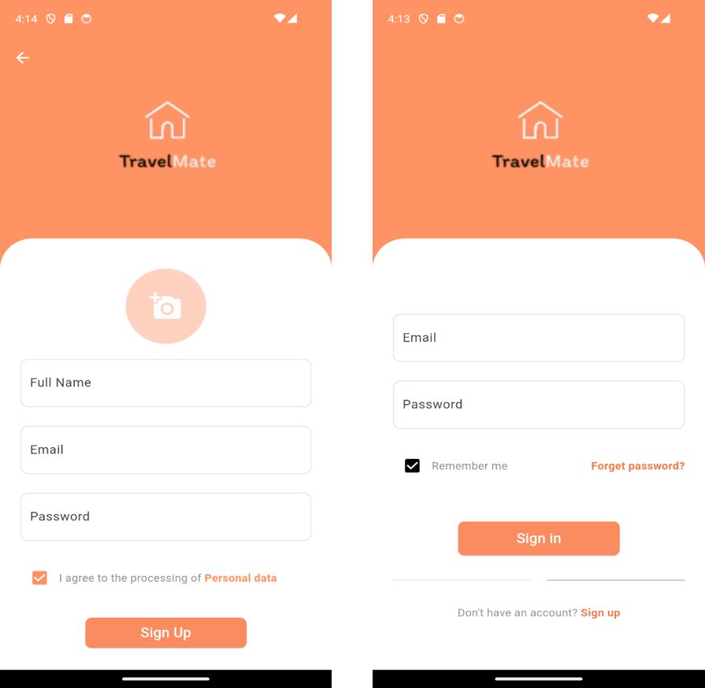
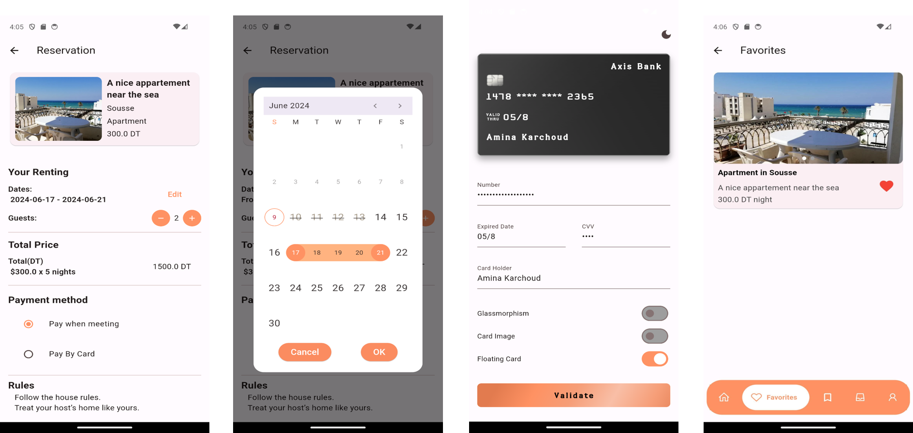
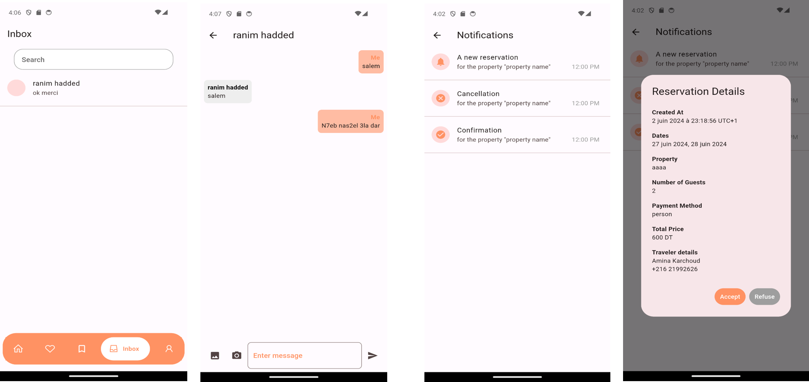

# TravelMate

A Flutter-based accommodation booking application developed as a final-year university project at ISET.

TravelMate connects travelers looking for accommodation with hosts who want to publish and manage their properties.

## Features

### Traveler
- User registration and authentication
- Browse available properties
- Search and filter accommodations
- View property details
- Manage favorite properties
- Make and manage reservations
- Chat and messaging
- Notifications
- User profile management

### Host
- Manage property listings
- Add and edit properties
- Upload property photos
- Set property prices and descriptions
- Manage availability and reservations
- Property calendar
- Messaging and notifications

## Technologies

- Flutter
- Dart
- Firebase Authentication
- Cloud Firestore
- Firebase Storage
- Provider / ViewModel architecture

## Project Structure

- `lib/Model/` — Application data models
- `lib/View/` — User interface screens
- `lib/ViewModel/` — Application logic and state management
- `lib/` — Application services and routing
- `assets/` — Images and other application assets

## Project Context

Developed as a university final-year project at ISET.

## Screenshots

### Authentication

### Property Listings

### Add a Property

### Reservations

### Traveler Bookings

### Messaging and Notifications

